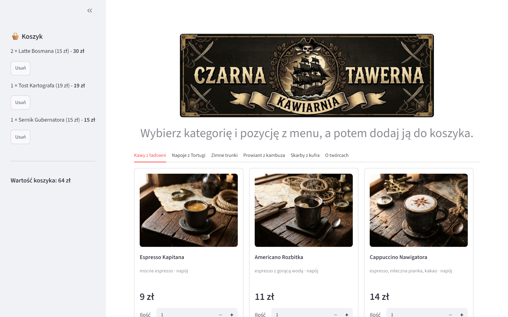

# 🏴‍☠️ Czarna Tawerna

> *W czarnej tawernie nad urwiskiem stromej śmierci*<br>
> *Gdzie pirackie włóczęgi, lichwiarze, mordercy*<br>
> *Każdy kotwicę wbił w drewniany ołtarz baru*<br>
> *Brzęczą łańcuchy zardzewiałego koszmaru*
>
> \- Leniwiec, „Czarna tawerna”

System zamówień w pirackiej tawernie - projekt semestralny z przedmiotu **Programowanie obiektowe II** (Akademia Humanistyczno-Ekonomiczna w Łodzi, Informatyka, rok akademicki 2026/2027).

Aplikacja działa jak kiosk samoobsługowy w tawernie-kawiarni: klient przegląda menu, dodaje pozycje do koszyka i widzi jego wartość. W kolejnych etapach dojdą m.in. rozmiary („Szalupa / Bryg / Galeon”), dodatki („łupy”), promocje i składanie zamówienia ze śledzeniem statusu.

> **Status:** etap 2 z 4 - menu i koszyk.



## Spis treści

- [Funkcje](#funkcje)
- [Technologia](#technologia)
- [Instalacja i uruchomienie](#instalacja-i-uruchomienie)
- [Testy](#testy)
- [Konfiguracja](#konfiguracja)
- [Najczęstsze problemy](#najczęstsze-problemy)
- [Struktura projektu](#struktura-projektu)
- [Wzorce projektowe](#wzorce-projektowe)
- [Specyfikacja (Spec-Driven Development)](#specyfikacja-spec-driven-development)
- [Współpraca](#współpraca)
- [Sprawozdanie i oddawanie](#sprawozdanie-i-oddawanie)
- [Autorzy](#autorzy)
- [Licencja i prawa](#licencja-i-prawa)

## Funkcje

- Menu w zakładkach kategorii (5 kategorii, 25 pozycji) wczytywane z pliku `dane/menu.json`.
- Każda pozycja jako kafelek: grafika, nazwa, opis, rodzaj (napój / danie), oznaczenia (np. „wege”), cena.
- Dodawanie do koszyka z wyborem ilości (1-20) - przycisk od razu pokazuje kwotę.
- Koszyk w panelu bocznym: wpisy z wartością, usuwanie pozycji, suma koszyka.
- Kwoty liczone dokładnie w groszach i wyświetlane w formacie „14,50 zł”.
- Koszyk przetrwa przeładowania strony w ramach jednej sesji przeglądarki.
- Zakładka „O twórcach” z opisem projektu i kartami zespołu.

## Technologia

- Python 3.10+ (sprawdzone na 3.10, 3.11 i 3.14)
- [Streamlit](https://streamlit.io/) 1.65+ - interfejs graficzny (starsze wersje nie obsługują części użytych funkcji)
- pytest - testy jednostkowe
- fpdf2 - pliki PDF (paragon - planowany)

Wszystkie biblioteki są w `requirements.txt` i instalują się jednym poleceniem do środowiska wirtualnego `.venv` w folderze projektu - niczego nie instaluje się globalnie poza samym Pythonem i Gitem.

## Instalacja i uruchomienie

Instrukcja ma cztery kroki: (1) zainstaluj Pythona i Gita, (2) pobierz projekt, (3) utwórz środowisko i zainstaluj biblioteki, (4) uruchom aplikację. Kroki 1, 3 i 4 różnią się między systemami - wybierz swój. Wszystkie polecenia wpisuje się w terminalu (Windows: **PowerShell**, Linux i macOS: **Terminal**).

Bez instalacji czegokolwiek projekt można też uruchomić w przeglądarce - zob. [GitHub Codespaces](#bez-instalacji-github-codespaces).

### 1. Python i Git

**Windows 10/11**

1. Zainstaluj Pythona 3.10 lub nowszego ze strony [python.org/downloads](https://www.python.org/downloads/). W pierwszym oknie instalatora **zaznacz „Add python.exe to PATH”**, potem „Install Now”. Zamiast tego można użyć polecenia `winget install Python.Python.3.12`.
2. Zainstaluj Gita ze strony [git-scm.com](https://git-scm.com/download/win) (domyślne opcje są w porządku) albo `winget install Git.Git`.
3. Zamknij i otwórz PowerShell na nowo, a potem sprawdź:

   ```powershell
   python --version   # Python 3.10 lub nowszy
   git --version
   ```

   Jeśli `python` otwiera Microsoft Store albo nie jest znany, użyj zamiast niego `py` (launcher Pythona) we wszystkich poleceniach poniżej albo zainstaluj Pythona jeszcze raz z zaznaczonym „Add to PATH”.

**Linux** (Ubuntu / Debian / Mint)

```bash
sudo apt update
sudo apt install python3 python3-venv python3-pip git
python3 --version   # Python 3.10 lub nowszy
```

Fedora: `sudo dnf install python3 python3-pip git`, Arch: `sudo pacman -S python python-pip git`. Jeśli systemowy Python jest starszy niż 3.10, zainstaluj nowszy (np. Ubuntu 20.04: `sudo add-apt-repository ppa:deadsnakes/ppa` i `sudo apt install python3.12 python3.12-venv`, a potem używaj `python3.12` zamiast `python3`).

**macOS**

1. Zainstaluj [Homebrew](https://brew.sh) (polecenie ze strony głównej), a potem:

   ```bash
   brew install python git
   python3 --version   # Python 3.10 lub nowszy
   ```

2. Bez Homebrew: Pythona można pobrać z [python.org/downloads](https://www.python.org/downloads/macos/), a Gita zainstaluje system po pierwszym wpisaniu `git` w Terminalu (narzędzia Xcode Command Line Tools).

Na Linuksie i macOS polecenie nazywa się `python3`, a nie `python` (do czasu aktywacji `.venv`).

### 2. Pobranie projektu

Repozytorium jest prywatne - potrzebne jest konto GitHub z dostępem (zaproszenie do repozytorium). Najprościej przez Git (przy pierwszym pobraniu Git poprosi o zalogowanie do GitHuba w przeglądarce):

```bash
git clone https://github.com/krystianr84/czarna-tawerna.git
cd czarna-tawerna
```

Inne sposoby: `gh repo clone krystianr84/czarna-tawerna` (po `gh auth login` w [GitHub CLI](https://cli.github.com)) albo na stronie repozytorium **Code → Download ZIP** i rozpakowanie archiwum. Wszystkie dalsze polecenia wykonuje się w folderze projektu (tam, gdzie leży `app.py`).

### 3. Środowisko wirtualne i biblioteki

**Windows (PowerShell)**

```powershell
python -m venv .venv
.venv\Scripts\Activate.ps1
python -m pip install --upgrade pip
pip install -r requirements.txt
```

Jeśli aktywacja kończy się błędem „running scripts is disabled on this system”, zezwól raz na lokalne skrypty i powtórz aktywację:

```powershell
Set-ExecutionPolicy -Scope CurrentUser -ExecutionPolicy RemoteSigned
```

W wierszu poleceń `cmd.exe` aktywacja to `.venv\Scripts\activate.bat`.

**Linux i macOS (Terminal)**

```bash
python3 -m venv .venv
source .venv/bin/activate
python -m pip install --upgrade pip
pip install -r requirements.txt
```

Po aktywacji na początku wiersza terminala pojawia się `(.venv)`, a polecenia `python`, `pip`, `streamlit` i `pytest` korzystają z bibliotek projektu. Aktywację powtarza się w każdym nowym oknie terminala (krok 3 bez tworzenia `.venv` i instalacji), a kończy poleceniem `deactivate`.

Instalacja z `requirements.txt` wystarczy raz; po zmianie tego pliku (np. po `git pull`) trzeba ją powtórzyć.

### 4. Uruchomienie aplikacji

Przy aktywnym środowisku `.venv`, we wszystkich systemach:

```bash
streamlit run app.py
```

Streamlit sam otworzy przeglądarkę z kioskiem; jeśli tego nie zrobi, wejdź na **http://localhost:8501**. Aplikację zatrzymuje się w terminalu skrótem **Ctrl+C**.

Bez aktywacji środowiska:

- Windows: `.\uruchom.ps1` - skrypt korzysta z Pythona w `.venv` i działa z dowolnego folderu (dodatkowe argumenty przekazuje do Streamlita, np. `.\uruchom.ps1 --server.port 8502`),
- Linux i macOS: `.venv/bin/python -m streamlit run app.py`.

### Bez instalacji: GitHub Codespaces

Repozytorium ma konfigurację środowiska deweloperskiego (`.devcontainer/devcontainer.json`, Python 3.11), więc projekt można uruchomić w przeglądarce, bez instalowania Pythona i Gita:

1. Na stronie repozytorium wybierz **Code → Codespaces → Create codespace on main**.
2. Codespaces sam zainstaluje biblioteki z `requirements.txt` i uruchomi `streamlit run app.py`.
3. Kiosk otworzy się w podglądzie (port 8501, karta **Ports** pokazuje adres do otwarcia w nowej karcie).

Codespaces dla prywatnych repozytoriów korzysta z darmowego limitu godzin konta GitHub osoby, która go uruchamia; nieużywany codespace warto zatrzymać lub usunąć (**Code → Codespaces**).

## Testy

Przy aktywnym środowisku `.venv`:

```bash
pytest                              # wszystkie testy (12)
pytest tests/test_zamowienia.py     # jeden plik
pytest -k test_suma_koszyka         # jeden test
pytest -v                           # lista testów z wynikami
```

Testy są w `tests/`, po jednym pliku na pakiet: `test_menu.py` (menu i fabryka), `test_zamowienia.py` (koszyk i dokładność kwot), `test_tawerna.py` (stan sesji kiosku). Korzystają z prawdziwego `dane/menu.json`, więc zmiana menu może zmienić ich wyniki.

Sprawdzenie stylu PEP 8 (narzędzie spoza `requirements.txt`, konfiguracja w `setup.cfg`: linie do 99 znaków, komentarze i docstringi do 72):

```bash
pip install pycodestyle
pycodestyle czarna_tawerna app.py tests
```

## Konfiguracja

Aplikacja nie wymaga kluczy, haseł ani bazy danych - działa od razu po instalacji.

- `.streamlit/config.toml` - ustawienia kiosku: ukryty przycisk „Deploy” i menu dewelopera, wyłączone wysyłanie statystyk do Streamlita. Plik jest wczytywany, gdy aplikację uruchamia się z folderu projektu.
- `dane/menu.json` - menu (kategorie, pozycje, ceny w złotych); nowe danie lub kategorię dodaje się samą zmianą tego pliku, bez zmian w kodzie.
- `dane/zdjecia/<id>.jpg` - grafika pozycji o danym `id` z menu; pozycja bez grafiki dostaje `brak.jpg`.
- Inny port niż 8501: `streamlit run app.py --server.port 8502`.

## Najczęstsze problemy

| Problem | Rozwiązanie |
|---|---|
| `python` / `python3` nie jest rozpoznawany | Python nie jest w PATH - zainstaluj ponownie z „Add to PATH” (Windows) albo użyj `py` / `python3` |
| „running scripts is disabled” przy aktywacji (Windows) | `Set-ExecutionPolicy -Scope CurrentUser -ExecutionPolicy RemoteSigned` |
| `error: externally-managed-environment` przy `pip install` (Linux, macOS) | biblioteki instaluje się tylko w aktywnym `.venv` - wykonaj najpierw `source .venv/bin/activate` |
| `No module named venv` / `ensurepip is not available` (Debian, Ubuntu) | `sudo apt install python3-venv` |
| `streamlit: command not found` | środowisko nie jest aktywne - aktywuj `.venv` (krok 3) albo użyj `python -m streamlit run app.py` |
| „Port 8501 is already in use” | aplikacja już działa w innym terminalu - zatrzymaj ją (Ctrl+C) albo użyj `--server.port 8502` |
| `TypeError: ... unexpected keyword argument` przy starcie | za stary Streamlit - `pip install -r requirements.txt --upgrade` (wymagany 1.65+) |
| Git przy `clone` zgłasza brak dostępu | repozytorium jest prywatne - zaakceptuj zaproszenie do repozytorium i zaloguj się do GitHuba |

## Struktura projektu

```text
app.py                    interfejs Streamlit (tylko prezentacja)
czarna_tawerna/           logika aplikacji (bez Streamlita)
  pieniadze.py            kwoty w groszach (int) i formatowanie „14,50 zł”
  menu/                   model menu, wczytywanie z JSON, fabryka pozycji
  zamowienia/             koszyk
  interfejs/              klasa Tavern (stan sesji kiosku)
dane/
  menu.json               menu: kategorie i pozycje z cenami
  zdjecia/                grafiki pozycji (<id>.jpg), brak.jpg, logo tawerny, crew.png;
                          pochodzenie grafik w ZRODLA.md
tests/                    testy pytest
specs/czarna-tawerna/     specyfikacja SDD: requirements.md, design.md, tasks.md
sprawozdanie/             generator sprawozdania DOCX, narzędzia do zrzutów, zasoby (diagram, zrzuty)
.streamlit/config.toml    ustawienia Streamlit dla kiosku
.devcontainer/            konfiguracja GitHub Codespaces
.github/                  szablony zgłoszeń (Issues) i pull requestów
CONTRIBUTING.md           zasady współpracy w zespole
CODE_OF_CONDUCT.md        kodeks postępowania
SECURITY.md               zgłaszanie problemów z bezpieczeństwem
LICENSE                   prawa autorskie (wszelkie prawa zastrzeżone)
requirements.txt          biblioteki aplikacji
pyproject.toml            metadane projektu i konfiguracja pytest
setup.cfg                 konfiguracja pycodestyle (PEP 8)
uruchom.ps1               uruchomienie bez aktywacji .venv (Windows)
```

Logika w pakiecie `czarna_tawerna` nie zależy od Streamlita - `app.py` korzysta z niej przez klasę `Tavern`. Zależności między pakietami idą w jedną stronę: `interfejs` → `zamowienia` → `menu` → `pieniadze`.

## Wzorce projektowe

| Wzorzec | Gdzie | Zastosowanie |
|---|---|---|
| Fabryka (fabryka prosta z rejestrem typów) | `menu/fabryka.py` | tworzenie pozycji menu (napój, danie) na podstawie pola `typ` z pliku; nowe rodzaje pozycji przez `register()` |

Kolejne etapy: Decorator (dodatki do produktu), Strategy (promocje) i Observer (powiadomienia o statusie zamówienia).

## Specyfikacja (Spec-Driven Development)

Projekt prowadzimy metodą Spec-Driven Development. W katalogu `specs/czarna-tawerna/` są trzy pliki, które czyta się po kolei:

1. [`requirements.md`](specs/czarna-tawerna/requirements.md) - wymagania (historyjki użytkownika i kryteria akceptacji),
2. [`design.md`](specs/czarna-tawerna/design.md) - projekt: architektura, klasy, wzorce, diagramy,
3. [`tasks.md`](specs/czarna-tawerna/tasks.md) - lista zadań z podziałem na osoby.

Najpierw zmieniamy specyfikację, potem kod.

## Współpraca

Zasady pracy w zespole - konwencje kodu, Spec-Driven Development, testy, praca z gałęziami i pull requestami - opisuje **[CONTRIBUTING.md](CONTRIBUTING.md)**. W skrócie:

- nazwy klas, metod i funkcji po angielsku, wszystko inne po polsku;
- najpierw specyfikacja, potem kod;
- przed wysłaniem zmian: `git pull`, `pytest` i `pycodestyle czarna_tawerna app.py tests` bez błędów.

Błędy i zadania zgłaszamy w zakładce **Issues** (szablony „Błąd” i „Zadanie”), a pull requesty mają gotową listę kontrolną. Zasady komunikacji: [CODE_OF_CONDUCT.md](CODE_OF_CONDUCT.md), zgłaszanie problemów z bezpieczeństwem: [SECURITY.md](SECURITY.md).

## Sprawozdanie i oddawanie

Sprawozdanie generuje skrypt `sprawozdanie/generuj_sprawozdanie.py` (plik wynikowy `sprawozdanie/programowanie2_sprawozdanie.docx`, nadpisywany tylko z opcją `--nadpisz`). Generator potrzebuje dodatkowo biblioteki `python-docx`, której celowo nie ma w `requirements.txt` (to narzędzie zespołu, nie część aplikacji):

```bash
pip install python-docx
python sprawozdanie/generuj_sprawozdanie.py --nadpisz
```

Gotowe pliki sprawozdania nie są przechowywane w repozytorium. Skrypty zrzutów ekranu opisuje [`sprawozdanie/narzedzia/README.md`](sprawozdanie/narzedzia/README.md).

Od etapu 2 oddaje się archiwum ZIP z kodem i sprawozdaniem - **bez** `.venv/`, `__pycache__/` i `.pytest_cache/`.

## Autorzy

| Osoba | Nr albumu | Rola | Zakres | Wzorce |
|---|---|---|---|---|
| Krystian Rutkowski (Szyper) | 167040 | kierownik, interfejs i integracja | `interfejs/`, `app.py` | Observer |
| Katarzyna Pater (Kwatermistrz) | 167683 | zamówienia | `zamowienia/` | Strategy, Observer |
| Dariusz Lorenz (Kuk) | 167014 | personalizacja (od kolejnego etapu; w etapie 2 - diagram klas) | `personalizacja/` (w poczekalni) | Decorator |
| Wiktor Purgał (Nawigator) | 165328 | menu | `menu/` | Fabryka |

## Licencja i prawa

Projekt edukacyjny, przygotowany na zajęcia z Programowania obiektowego II w AHE w Łodzi. **Wszelkie prawa zastrzeżone** przez autorów - kod nie jest udostępniony na wolnej licencji (zob. [LICENSE](LICENSE)).

Treści osób trzecich:

- **Motto** - fragment tekstu utworu „Czarna tawerna” zespołu Leniwiec, przytoczony jako cytat; prawa należą do autorów utworu.
- **Grafiki** - logo tawerny, grafiki produktów i obrazek załogi (`crew.png`) wygenerowano modelem AI Nano Banana (Google Gemini); szczegóły w [`dane/zdjecia/ZRODLA.md`](dane/zdjecia/ZRODLA.md). Postacie na `crew.png` są inspirowane grą Among Us (Innersloth) - obrazek służy wyłącznie jako ilustracja w projekcie edukacyjnym.
- **Biblioteki** - Streamlit, pytest i fpdf2 mają własne licencje open source.
