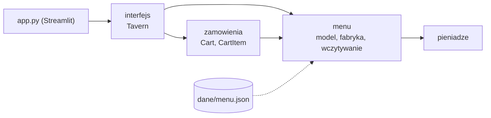
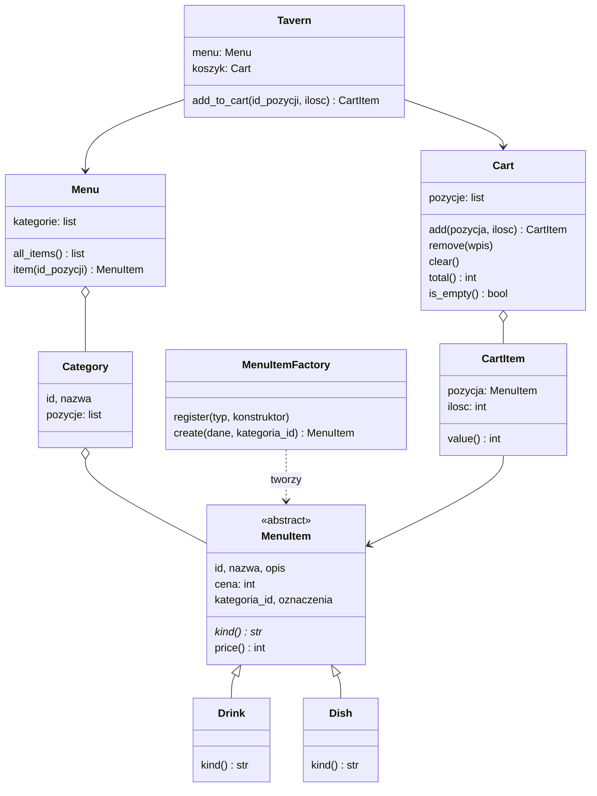
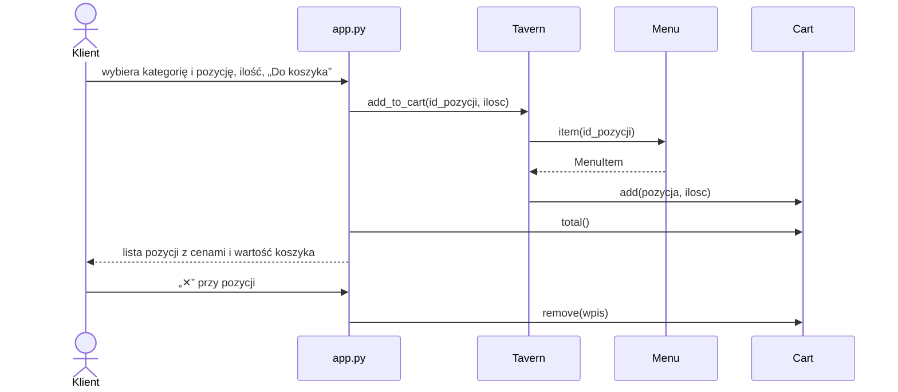

# Projekt - Czarna Tawerna

Druga część specyfikacji: [wymagania](requirements.md) → **projekt** (ten plik) → [zadania](tasks.md). Numery W0-W9 i N1-N11 odnoszą się do wymagań.

Plik opisuje **stan projektu w etapie 2** (menu i koszyk). Rozwiązania na kolejne etapy - rozmiary, dodatki (Decorator), promocje (Strategy), zamówienie ze statusami i tablica statusów (Observer), paragon PDF - są zaprojektowane i zaimplementowane w poczekalni (`../Projekt_poczekalnia/`, opis w `POCZEKALNIA.md`, pełny projekt w jej `specs/czarna-tawerna/design.md`). Wracają do projektu, gdy obejmie je instrukcja etapu.

## Przegląd

Aplikacja ma dwie warstwy:

- **logika** - pakiet `czarna_tawerna`, bez zależności od interfejsu (N2),
- **interfejs** - `app.py` w Streamlit, który rozmawia z logiką przez klasę `Tavern`.

Pakiety logiki odpowiadają rolom w zespole, a zależności idą w jedną stronę:

| Pakiet | Rola | Odpowiada za w etapie 2 | Wymagania |
|---|---|---|---|
| `menu` | 1 - Nawigator (Wiktor Purgał) | model menu, wczytywanie z JSON, fabryka pozycji | W1 |
| `zamowienia` | 3 - Kwatermistrz (Katarzyna Pater) | koszyk | W4 |
| `interfejs` + `app.py` | 4 - Szyper (Krystian Rutkowski) | stan sesji kiosku, GUI | W9.1-9.3 |
| `pieniadze.py` | wspólny | zamiana zł ↔ grosze, formatowanie kwot | N5, W9.3 |

Pakiet `personalizacja` (rola 2 - Kuk, Dariusz Lorenz) wraca z poczekalni razem z rozmiarami i dodatkami; w etapie 2 Dariusz Lorenz odpowiada za diagram klas w sprawozdaniu (zadanie 8.14).

## Model klas

Konwencja nazw (N10): klasy, metody i funkcje po angielsku; atrybuty, parametry, zmienne i nazwy modułów po polsku. Dlatego np. `MenuItem` ma pola `nazwa` i `cena`, a metodę `price()`.

`MenuItem` jest abstrakcyjna (`ABC`); konkretne `Drink` i `Dish` różnią się metodą `kind()` („napój” / „danie”), a w kolejnych etapach także zachowaniem (np. rozmiary tylko dla napojów - poczekalnia).

## Wzorce projektowe

Stosujemy tylko cztery wzorce (N3). W etapie 2 w kodzie jest **Fabryka**; Decorator, Strategy i Observer czekają w poczekalni na swoje etapy.

### Fabryka (fabryka prosta z rejestrem typów) - tworzenie pozycji menu (W1.4-1.7)

- **Problem:** plik JSON opisuje pozycje różnych rodzajów (pole `typ`), a reszta programu ma dostać gotowe obiekty `Drink` lub `Dish`.
- **Rozwiązanie:** `MenuItemFactory` (`menu/fabryka.py`) trzyma słownik `typ → konstruktor`. `load_menu()` woła `fabryka.create(dane, kategoria_id)` i nie zna konkretnych klas.
- **Rozszerzanie:** nowy rodzaj pozycji dodaje się przez `register(typ, konstruktor)` - bez zmiany fabryki (Open/Closed). Nieznany typ → `ValueError`.
- **Wariant (decyzja 2026-11-02, zadanie 8.2):** fabryka prosta z rejestrem typów (ang. *Simple Factory*). Instrukcja etapu 2 pozwala wybrać wariant. Wybór wynika z problemu: plik menu opisuje pozycje polem `typ`, więc potrzebne jest jedno miejsce, które wybiera klasę po kluczu, a rejestr pozwala dodać nowy rodzaj pozycji bez zmiany fabryki.
- **Odrzucone warianty:** klasyczny GoF Factory Method - wymaga hierarchii klas twórców, a w tawernie nie ma naturalnej rodziny twórców (przy dwóch rodzajach pozycji podklasy fabryki byłyby sztuczne; *Python Patterns Guide* B. Rhodesa, polecany przez prowadzącego, wskazuje, że w Pythonie wystarczy przekazać klasę lub funkcję); Abstract Factory - brak rodzin powiązanych produktów.

## Etap 2 - materiał do rozdziału 2 sprawozdania

### Diagram klas (2.1)

Model klas z sekcji wyżej - obejmuje całą logikę etapu 2. Diagram renderowany z Mermaid do obrazka (PNG) wstawianego do sprawozdania.

### Fabryka w projekcie (2.2)

- **Role klas:** `MenuItemFactory` - tworzy obiekt wg pola `typ`; `MenuItem` - wspólny abstrakcyjny typ produktów fabryki; `Drink`, `Dish` - konkretne produkty; `load_menu()` - klient fabryki, który nie zna konkretnych klas.
- **Nowe danie lub kategoria:** wpis w `dane/menu.json` - bez zmiany kodu (W1.7).
- **Nowy rodzaj pozycji:** nowa podklasa `MenuItem` i `fabryka.register("typ", konstruktor)` - bez zmiany fabryki ani `load_menu()` (W1.5).
- **Interfejs:** `app.py` nie wywołuje konstruktorów pozycji; dostaje gotowe obiekty z `Tavern.menu` i dodaje je do koszyka przez `Tavern.add_to_cart(id)` (W1.6).

### Oddzielenie logiki od interfejsu (2.3)

- Pakiet `czarna_tawerna` nie importuje Streamlita (N2); można go testować i uruchomić bez interfejsu.
- `app.py` tylko wyświetla dane i wywołuje metody `Tavern` i `Cart`; nie liczy cen ani nie sprawdza reguł (wartość pozycji i koszyka liczą `CartItem.value()` i `Cart.total()`).
- `Tavern` trzymana jest w `st.session_state`, żeby koszyk przetrwał przeładowania Streamlita (W9.2).
- Menu to kafelki w zakładkach kategorii (zdjęcie, nazwa, opis, cena, ilość, przycisk „Do koszyka”). Zdjęcie dobiera `app.py` po `id` pozycji (`dane/zdjecia/<id>.jpg`, w razie braku `brak.jpg`) - to sprawa prezentacji, więc model `MenuItem` nie ma pola ze zdjęciem (W9.5, W9.6).
- Błędy logiki to wyjątki (`ValueError`, `KeyError`); interfejs nie dopuszcza do błędnych akcji (pole ilości przyjmuje tylko 1-20, usuwanie dotyczy pozycji widocznej w koszyku).

### Decyzje projektowe (2.4)

| Decyzja | Uzasadnienie | Rozważane alternatywy |
|---|---|---|
| kwoty w groszach (`int`), ceny w JSON w zł zamieniane funkcją `pln()` | dokładne dodawanie i mnożenie, prosty typ, łatwe testy (N5) | `float` - błędy zaokrągleń; `Decimal` - dokładny, ale trzeba pilnować kontekstu i konwersji przy każdej operacji |
| menu w pliku `dane/menu.json` | zmiana karty bez zmiany kodu (W1.7) | menu zapisane w kodzie; baza danych - zbędna przy tej skali |
| pakiety wg ról w zespole, zależności w jedną stronę | każda osoba ma swój pakiet, brak cykli importów | jeden moduł logiki; podział wg warstw technicznych |
| fabryka prosta z rejestrem typów | jedno miejsce wybiera klasę po polu `typ`; nowe typy bez zmiany fabryki (Open/Closed) | `if`/`match` po polu `typ` w `load_menu()` - każdy nowy typ zmienia ten kod; klasyczny Factory Method - sztuczna hierarchia twórców; Abstract Factory - brak rodzin produktów |
| `Tavern` w `st.session_state` | Streamlit uruchamia skrypt od nowa przy każdej akcji | zmienne globalne modułu - wspólne dla wszystkich sesji |
| `Cart` z listą `CartItem` (pozycja + ilość), usuwanie po tożsamości wpisu | każde dodanie to osobny wiersz, który klient może usunąć; gotowe na kolejne etapy, w których ta sama pozycja z innymi dodatkami będzie osobnym wierszem | słownik `id → ilość` - prostszy, ale nie odróżni wariantów produktu |
| zakres kodu ograniczony do etapu 2, reszta w poczekalni | kod oddawany w etapie odpowiada jego instrukcji; prostszy do opisania i obrony | zostawienie gotowych funkcji kolejnych etapów w projekcie |

### Zrzuty ekranu (2.5)

- kiosk z menu (zakładki kategorii) i koszykiem z kilkoma pozycjami i wartością koszyka - `sprawozdanie/zasoby/zrzut_kiosk_menu_koszyk.png`,
- wynik `pytest -v` (wszystkie testy przechodzą) - `sprawozdanie/zasoby/zrzut_pytest.png`.

Diagram klas: `sprawozdanie/zasoby/diagram_klas_etap2.png`. Wszystkie trzy obrazki odtwarzają skrypty z `sprawozdanie/narzedzia/` (opis w tamtejszym `README.md`) - po zmianach w kodzie trzeba je wygenerować ponownie.

## Przepływ: od wyboru do koszyka

## Dane

`dane/menu.json` zawiera `kategorie[]`: `id`, `nazwa`, `pozycje[]`; pozycja: `id`, `typ` (`napoj` / `danie`), `nazwa`, `opis`, `cena` (w zł), opcjonalnie `oznaczenia`.

Ceny w JSON są w złotych; przy wczytywaniu zamieniane na grosze funkcją `pln()` (N5). Ceny napojów odpowiadają rozmiarowi Szalupa z rozdziału 1; rozmiary i dodatki („łupy”) wrócą do pliku z poczekalni.

## Obsługa błędów

| Sytuacja | Wyjątek |
|---|---|
| nieznany typ pozycji w JSON | `ValueError` |
| ilość < 1 | `ValueError` |
| usuwanie pozycji, której nie ma w koszyku | `ValueError` |
| brak pozycji o podanym `id` | `KeyError` |

## Strategia testów

- pytest, testy w `tests/` - po jednym pliku na pakiet (`test_menu.py`, `test_zamowienia.py`, `test_tawerna.py`).
- Wspólne fixture'y w `tests/conftest.py`: `menu` (prawdziwy `dane/menu.json`) i `tawerna`.
- Testowana jest logika, nie interfejs Streamlit (N2 to umożliwia).
- Fabryka: tworzy właściwy typ, przepisuje dane, odrzuca nieznany typ, przyjmuje nowy typ przez `register()`; nowa kategoria wymaga tylko zmiany JSON.
- Koszyk: suma, dodawanie, usuwanie, usuwanie pozycji spoza koszyka, czyszczenie, ilość < 1, dokładność kwot.
- Przypadki błędne mają testy z `pytest.raises`, a każdy test sprawdza konkretny wynik (N6).
- Styl PEP 8 sprawdza `pycodestyle czarna_tawerna app.py tests` (konfiguracja w `setup.cfg`).

## Otwarte decyzje

- Zakres etapów 3-4 - po publikacji instrukcji; wtedy decyzja, które elementy wracają z poczekalni.
- Osobny widok obsługi (np. druga strona Streamlit) zamiast sekcji w widoku kiosku - gdy wróci panel obsługi.
- Program lojalnościowy (Karta Załogi) i zestawy - czy wracają.
- Czy zamówienia mają przetrwać zamknięcie aplikacji.
